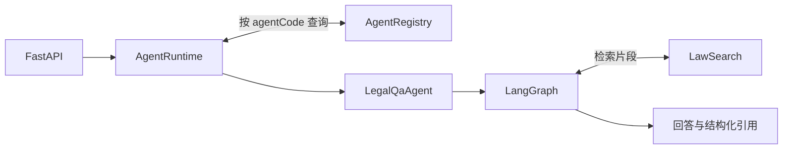

# 律枢（LexNexus）——多智能体法律智能服务平台

LexNexus 是面向法律应用的个人软件工程项目。仓库包含 Vue 前端、Spring Boot Java 后端和 Python AI-Service。Java 后端已具备独立启动、健康检查和调用 AI-Service 的客户端；Python 服务通过统一 HTTP 接口按 `agentCode` 调用 Agent。首个 Agent `legal_qa` 可使用固定测试材料离线验证检索、引用校验和回答流程。

## 当前功能

- Vue Web 前端可独立启动并展示登录、注册与 404 页面。业务操作待 Java 后端联调，启动方式见 [前端说明](frontend/README.md)。
- Java 后端提供 `GET /api/v1/health` 和内部 `AiServiceClient`，目前没有对外法律问答、认证或合同审查业务接口。启动、配置与测试方式见 [Java 后端说明](java-backend/README.md)。
- `POST /api/v1/agent/invoke` 接收 Agent 代码、业务输入和请求上下文。
- Legal QA 返回回答和结构化引用。检索无命中时返回空引用和无直接依据提示。
- 请求格式错误、业务输入错误、未知 Agent 和模型调用失败均有明确的 HTTP 状态及错误码。
- 检索通过 `LawSearch` 注入，默认使用 Fake 检索，也可配置本地 BGE 与 Milvus Lite。DeepSeek 由独立的 LLM 模式控制。

## 技术栈与目录

前端使用 Vue 3；Java 后端使用 Java 21、Spring Boot 3.5.16 和 Maven；AI-Service 使用 CPython 3.14、uv、FastAPI、Pydantic、LangGraph、LangChain、Uvicorn、Pytest 和 Ruff。

```text
LexNexus/
├── ai-service/
│   ├── app/
│   │   ├── main.py         # FastAPI 入口与应用装配
│   │   ├── agent/          # Agent 契约、注册、调用及 Legal QA 工作流
│   │   ├── api/            # HTTP 路由与异常处理
│   │   ├── core/           # 环境配置
│   │   ├── llm/            # DeepSeek 适配器
│   │   ├── schemas/        # 请求、响应和引用契约
│   │   └── tools/law.py    # LawSearch 接口与 Fake 检索
│   ├── tests/
│   ├── LICENSES/
│   ├── .env.example
│   ├── pyproject.toml
│   └── uv.lock
├── docs/migration/sources.md
├── frontend/               # Vue Web 前端
├── java-backend/           # Spring Boot 基础工程、健康检查与 AI-Service 客户端
└── README.md
```

## Agent 调用架构



Registry 保存 Agent 注册项。Runtime 查找并调用对应实例。LegalQaAgent 校验业务输入后启动 Graph。Graph 将具备来源标识和引用文本的片段用于回答生成，并返回这些结构化引用。

## 本地运行

使用标准构建的 CPython 3.14 和 uv，从仓库根目录执行：

```powershell
cd ai-service
$env:AI_SERVICE_MODE = 'fake'
$env:AI_SERVICE_LAW_SEARCH_BACKEND = 'fake'
uv sync --locked
uv run --locked uvicorn app.main:app --host 127.0.0.1 --port 8000
```

启动后可打开 [本地 Swagger UI](http://127.0.0.1:8000/docs)。也可以另开 PowerShell 窗口发送请求：

```powershell
$body = @{
    agentCode = 'legal_qa'
    input = @{ question = '合同违约金如何处理？' }
    context = @{ requestId = 'qa-example' }
} | ConvertTo-Json -Depth 4
Invoke-RestMethod -Uri 'http://127.0.0.1:8000/api/v1/agent/invoke' `
    -Method Post -ContentType 'application/json; charset=utf-8' `
    -Body ([Text.Encoding]::UTF8.GetBytes($body)) | ConvertTo-Json -Depth 8
```

成功响应包含 `requestId`、`data.answer` 和 `data.citations`。使用默认 Fake 检索时，包含“违约金”的问题命中一条标记为离线测试材料的引用。

Java 后端可独立启动，无需先运行 AI-Service：

```powershell
cd java-backend
mvn spring-boot:run
```

另开终端访问 `http://127.0.0.1:8080/api/v1/health` 可检查 Java 进程。健康检查不验证 AI-Service 连通性；`AiServiceClient` 仅供后续 Java 业务层调用，当前没有前端可用的法律问答 API。Java 后端的测试和打包命令见 [模块说明](java-backend/README.md)。

## 检索后端与 LLM 模式

| `AI_SERVICE_MODE` | `AI_SERVICE_LAW_SEARCH_BACKEND` | 行为 |
| --- | --- | --- |
| `fake` | `fake` | 默认使用固定测试材料和离线应答。 |
| `fake` | `vector` | 使用本地 BGE 与 Milvus Lite 返回引用，答案仍为离线提示。 |
| `live` | `vector` | 使用向量检索和 DeepSeek，需要配置模型凭据。 |

向量模式需要 `rag` extra、本地 BGE 快照及已入库的 Milvus Lite Collection，配置见 [环境变量模板](ai-service/.env.example)。同一 Lite 数据库仅由一个服务进程打开。通过 `create_app(..., law_tool=...)` 显式注入的检索器优先于后端配置，`live` 模式要求真实检索器。

使用向量检索时，还需通过 `AI_SERVICE_CITATION_REFERENCE_SOURCE_PATH` 和 `AI_SERVICE_CITATION_REFERENCE_METADATA_PATH` 指定已独立核验的本地 UTF-8 法律原文及 JSON 版本元数据。元数据包含 `document_id`、`law_name`、`source_url` 和 `version_basis`。服务启动时切分并加载快照，核对检索引用的版本、条号、法律名称及完整正文。快照缺失或加载失败会阻止启动。开发时可显式使用仓库法律样本进行验证。

## 自动化测试

在 `ai-service` 目录执行：

```powershell
uv sync --locked --extra dev
uv run --locked --extra dev ruff check .
uv run --locked --extra dev ruff format --check .
uv run --locked --extra dev pytest
```

测试覆盖 Agent 注册与调用、Legal QA 检索与引用校验、HTTP 输入校验及模拟模型故障。

## 路线图

1. 扩充法律知识库，验证检索质量、引用可追溯性和回答依据。
2. 扩展独立的法律场景 Agent，例如合同审查。
3. 在 Java 后端实现认证与业务 API 后，接通前端的合同审查与法律问答流程。

## 许可

第三方派生部分保留原 [MIT 许可证及版权声明](ai-service/LICENSES/upstream-MIT.txt)，对应文件见 [代码来源](docs/migration/sources.md)。LexNexus 独立新增部分的许可证由项目维护者确认。
