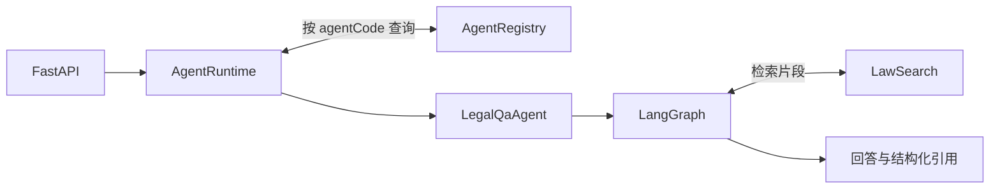

# 律枢（LexNexus）——多智能体法律智能服务平台

LexNexus 是面向法律应用的个人软件工程项目。当前提供可独立运行的 Python AI Service，通过统一的 HTTP 接口按 `agentCode` 调用 Agent。首个 Agent `legal_qa` 实现从检索、引用校验到回答生成的工作流，可使用固定测试材料离线验证。

## 当前功能

- `POST /api/v1/agent/invoke` 接收 Agent 代码、业务输入和请求上下文。
- Legal QA 返回回答和结构化引用。检索无命中时返回空引用和无直接依据提示。
- 请求格式错误、业务输入错误、未知 Agent 和模型调用失败均有明确的 HTTP 状态及错误码。
- 检索通过 `LawSearch` 注入。默认提供 Fake 检索，并预留由 DeepSeek 生成回答的运行模式。

## 技术栈与目录

CPython 3.14、uv、FastAPI、Pydantic、LangGraph、LangChain、Uvicorn、Pytest 和 Ruff。

```text
LexNexus/
├── ai-service/
│   ├── app/
│   │   ├── main.py         # FastAPI 入口与应用装配
│   │   ├── agent/          # Agent 契约、注册、调用及 Legal QA 工作流
│   │   ├── api/            # HTTP 路由与异常处理
│   │   ├── core/           # 环境配置
│   │   ├── llm/            # DeepSeek 适配器
│   │   ├── schemas/        # 请求、响应和引用契约
│   │   └── tools/law.py    # LawSearch 接口与 Fake 检索
│   ├── tests/
│   ├── LICENSES/
│   ├── .env.example
│   ├── pyproject.toml
│   └── uv.lock
├── docs/migration/sources.md
└── README.md
```

## Agent 调用架构



Registry 保存 Agent 注册项。Runtime 查找并调用对应实例。LegalQaAgent 校验业务输入后启动 Graph。Graph 将具备来源标识和引用文本的片段用于回答生成，并返回这些结构化引用。

## 本地运行

使用标准构建的 CPython 3.14 和 uv，从仓库根目录执行：

```powershell
cd ai-service
$env:AI_SERVICE_MODE = 'fake'
uv sync --locked
uv run --locked uvicorn app.main:app --host 127.0.0.1 --port 8000
```

启动后可打开 [本地 Swagger UI](http://127.0.0.1:8000/docs)。也可以另开 PowerShell 窗口发送请求：

```powershell
$body = @{
    agentCode = 'legal_qa'
    input = @{ question = '合同违约金如何处理？' }
    context = @{ requestId = 'qa-example' }
} | ConvertTo-Json -Depth 4
Invoke-RestMethod -Uri 'http://127.0.0.1:8000/api/v1/agent/invoke' `
    -Method Post -ContentType 'application/json; charset=utf-8' `
    -Body ([Text.Encoding]::UTF8.GetBytes($body)) | ConvertTo-Json -Depth 8
```

成功响应包含 `requestId`、`data.answer` 和 `data.citations`。在 Fake 模式下，包含“违约金”的问题命中一条标记为离线测试材料的引用。

## Fake 与 Live 模式

| 模式 | 检索与回答 |
| --- | --- |
| `fake`（默认） | 使用固定测试材料和固定应答，启动无需模型密钥。适合本地开发和自动化测试。 |
| `live` | 使用由 `create_app(..., law_tool=...)` 注入的法律检索实现及 DeepSeek 适配器。配置项见 [环境变量模板](ai-service/.env.example)。真实检索尚待实现，当前可直接启动 Fake 模式。 |

## 自动化测试

在 `ai-service` 目录执行：

```powershell
uv sync --locked --extra dev
uv run --locked --extra dev ruff check .
uv run --locked --extra dev ruff format --check .
uv run --locked --extra dev pytest
```

测试覆盖 Agent 注册与调用、Legal QA 检索与引用校验、HTTP 输入校验及模拟模型故障。

## 路线图

1. 接入法律知识库与 RAG，验证检索质量、引用可追溯性和回答依据。
2. 扩展独立的法律场景 Agent，例如合同审查。
3. 接入 Java 后端和前端，逐步完善面向用户的业务流程。

## 许可

第三方派生部分保留原 [MIT 许可证及版权声明](ai-service/LICENSES/upstream-MIT.txt)，对应文件见 [代码来源](docs/migration/sources.md)。LexNexus 独立新增部分的许可证由项目维护者确认。
