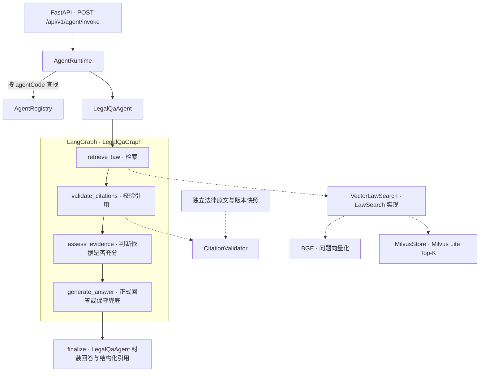

# 律枢（LexNexus）——多智能体法律智能服务平台

律枢（LexNexus）是可扩展的多智能体法律智能服务平台，当前聚焦可追溯的中文法律问答。调用方通过统一 HTTP 接口提问，服务检索法条、核对原文，在依据充分时返回回答和结构化引用。目前已注册的 Agent 为 `LegalQaAgent`。

[快速体验](#本地运行) · [系统架构](#系统架构) · [测试与评测](#工程测试与评测结果)

## 项目亮点

- **可扩展的 Agent 调度**。FastAPI 按 `agentCode` 调用已注册的 Agent。LangGraph 将检索、校验、判断和回答分成独立节点，便于测试各步骤和短路条件。
- **本地法条语义检索**。BGE 在本地编码中文问题和法条，Milvus Lite 持久化向量并按余弦相似度取候选，支持小规模语料的本地检索。
- **确定性的引用核验**。使用独立的法律原文快照，对照文档版本、片段 ID、条号和完整正文，过滤不一致的引用。
- **依据不足时保守兜底**。DeepSeek 先判断已核验法条是否能直接支撑回答。只有选出的引用 ID 通过本地校验，才进入正式回答生成。

## 当前开发状态

| 状态 | 模块 | 当前边界 |
| --- | --- | --- |
| 已完成并验证 | Python AI-Service | 基于《民法典》第 577–584 条的 8 条样本，完成真实 DeepSeek、BGE 与 Milvus Lite 的问答人工验收，覆盖回答生成、依据不足兜底和 PyCharm 断点验证。 |
| 已实现基础能力，待业务联调 | Java Backend | 可独立启动，提供 `GET /api/v1/health` 和内部 `AiServiceClient`。认证及对外业务 API 待开发。 [Java 后端说明](java-backend/README.md) |
| 已实现界面与接口封装，待业务联调 | Vue 3 前端 | 可独立查看登录、注册和 404 页面。法律问答和合同审查已具备页面与请求封装，业务操作待对接 Java API。 [前端说明](frontend/README.md) |
| 已完成并验证 | MySQL 8 权威法律数据 | 已实现法律版本与条文存储。《中华人民共和国民法典》2020 年版第 577–594 条共 18 条已完成真实 MySQL 离线导入，覆盖首次新增 8 条、扩充新增 10 条和重复导入新增 0 条。MySQL 数据尚未同步发布到 Milvus 在线检索索引。 |
| 后续规划 | 数据发布、业务闭环与 Agent 扩展 | MySQL 与 Milvus 索引的同步发布、法律数据版本治理、Java 业务接口和 Vue 端到端联调、合同审查等独立 Agent。 |

## 技术栈

| 模块 | 技术 | 用途 |
| --- | --- | --- |
| AI-Service | Python 3.14、FastAPI、Pydantic、LangGraph、DeepSeek | HTTP 契约、Agent 编排与模型调用 |
| RAG | BGE-small-zh-v1.5、Milvus Lite | 本地中文向量编码、持久化与 Top-K 检索 |
| 权威法律数据 | MySQL 8、PyMySQL | 法律版本与条文存储、幂等离线导入 |
| Java Backend | Java 21、Spring Boot 3、Maven | 健康检查与内部 AI-Service HTTP 客户端 |
| Web 前端 | Vue 3、TypeScript、Element Plus、Vite | 页面、路由及请求封装 |

## 系统架构



实线表示 Agent 调用与节点执行顺序，虚线表示向量模式的依赖。FastAPI lifespan 在启动时装配模型、存储和引用校验器，退出时等待在途检索完成，再关闭服务持有的 Milvus 存储。无候选引用或全部校验失败时，工作流返回无直接依据提示和空引用列表，跳过模型调用。

## Agent 工作流与 RAG 实现

在 `live + vector` 模式下，`assess_evidence` 判断已核验的法条能否直接支撑回答。只有 `supported` 且引用 ID 通过本地校验时，才使用选中的引用调用正式回答模型。`insufficient`、`uncertain` 或无效判断输出会返回保守提示和空引用列表，跳过正式回答模型。判断服务故障沿用 HTTP `503 LLM_UNAVAILABLE`。图中的 `finalize` 是工作流结束后由 `LegalQaAgent` 封装回答与结构化引用的步骤。

### 法律检索与引用校验

- **离线入库**将本地 UTF-8 法律原文按条切分为 `LawChunk`，保留文档版本、片段 ID、法律名称、条号、正文及来源 URL。使用 `BAAI/bge-small-zh-v1.5` 编码正文，并把向量和原文写入 Milvus Lite。
- **在线检索**由 `VectorLawSearch` 实现统一的 `LawSearch` 接口。它使用本地 BGE 对问题编码，按余弦相似度从 Milvus Lite 取 Top-K 候选，再映射为结构化引用。真实 BGE + Milvus 检索链路已完成 HTTP 联调。
- **确定性校验**使用独立的法律原文与版本元数据构建参考索引。回答前逐条核对文档版本 `document_id`、片段 ID `kb_chunk_id`、法律名称、条号及完整正文。不一致的引用会从提示词和 API 响应中移除。快照缺失、无法读取或解析失败会使向量模式启动失败。

## 工程测试与评测结果

### 自动化测试

在 `ai-service/` 运行 Pytest 和 Ruff。

```powershell
uv sync --locked --extra dev
uv run --locked --extra dev ruff check app scripts tests
uv run --locked --extra dev ruff format --check app scripts tests
uv run --locked --extra dev pytest
```

RAG-04 发布前的默认 Pytest 回归结果为 270 项通过、3 项跳过。真实 BGE 和 Milvus Lite 集成测试需显式启用。默认测试覆盖 Agent 注册与调用、原文校验、依据不足与非法判断结果、FastAPI 装配与资源关闭、HTTP 输入校验及模拟模型故障。API 区分无可用引用、输入校验失败、Agent 不存在和模型调用失败。 [生命周期测试](ai-service/tests/test_app_lifespan.py) · [Legal QA API 测试](ai-service/tests/test_legal_qa.py)

RAG-05-B 在已安装 `mysql` 可选依赖的环境中完成默认回归，316 项通过、3 项跳过。批次冲突回滚已有替身测试覆盖，真实 MySQL 的冲突回滚尚待单独集成验证。

### 离线检索评测

RAG-04 评测使用《中华人民共和国民法典》第 577–584 条，共 8 条法律样本。28 道人工标注问题包括 14 道库内问题、7 道完全无关问题和 7 道库外法律问题。Hit@K 统计库内问题的前 K 条检索结果中至少包含一条预期法条的比例。 [原文样本](ai-service/tests/fixtures/civil_code_2020_articles_577_584.txt) · [评测题集](ai-service/tests/fixtures/law_search_relevance.json)

| 库内检索指标 | 结果 |
| --- | ---: |
| Hit@1 | 12/14（85.7%） |
| Hit@3 | 13/14（92.9%） |

这是小规模样本实验，结果仅衡量预期法条在该题集中的检索命中，不能代表通用法律问答准确率。库内问题与库外法律问题的 Top-1 相似度存在重叠，单一相似度阈值无法可靠判断法律规则是否在知识库中得到覆盖。阈值比较仅用于离线评测，线上仍按 Top-K 召回。 [评测脚本](ai-service/scripts/eval_law_search.py) · [阈值分析脚本](ai-service/scripts/analyze_law_search_thresholds.py)

## 项目目录

```text
LexNexus/
├── ai-service/
│   ├── app/
│   │   ├── main.py                     # FastAPI 入口与生命周期
│   │   ├── agent/                      # 注册、调度与 Legal QA 工作流
│   │   ├── api/                        # HTTP 路由与异常处理
│   │   ├── core/                       # 环境配置
│   │   ├── llm/                        # DeepSeek 适配器
│   │   ├── schemas/                    # 请求、响应、Citation 与 LawChunk
│   │   └── tools/
│   │       ├── law.py                  # LawSearch 与 Fake 检索
│   │       ├── law_splitter.py         # 法条切分
│   │       ├── bge_embedding.py        # 本地 BGE 编码
│   │       ├── milvus_store.py          # Milvus Lite 存储与检索
│   │       ├── vector_law_search.py     # 向量检索适配器
│   │       └── citation_validator.py   # 引用一致性校验
│   ├── scripts/
│   │   ├── ingest_laws.py              # 法律原文离线入库
│   │   ├── eval_law_search.py          # 离线检索评测
│   │   └── analyze_law_search_thresholds.py
│   ├── tests/
│   ├── LICENSES/
│   ├── .env.example
│   ├── pyproject.toml
│   └── uv.lock
├── docs/migration/sources.md
├── frontend/
├── java-backend/
└── README.md
```

## 本地运行

AI-Service 使用 CPython 3.14 和 uv。检索后端与回答模式独立配置。

| 使用场景 | `AI_SERVICE_MODE` | `AI_SERVICE_LAW_SEARCH_BACKEND` | 响应 |
| --- | --- | --- | --- |
| 默认 Fake 模式 | `fake` | `fake` | 固定测试材料与离线提示 |
| 真实向量检索 | `fake` | `vector` | 从 Milvus Lite 返回通过校验的引用，答案字段为离线提示 |
| DeepSeek 模型模式 | `live` | `vector` | 先判断依据是否充分，再使用通过校验且获选的引用生成回答，需配置模型凭据 |

### 快速体验（默认 Fake 模式）

从仓库根目录启动服务。Fake 模式使用固定测试材料验证请求、响应与引用传递，无需配置 DeepSeek 密钥、本地 BGE 模型或 Milvus 数据库。

```powershell
cd ai-service
$env:AI_SERVICE_MODE = 'fake'
$env:AI_SERVICE_LAW_SEARCH_BACKEND = 'fake'
uv sync --locked
uv run --locked uvicorn app.main:app --host 127.0.0.1 --port 8000
```

启动后可用 Swagger UI 或在另一个 PowerShell 窗口发送请求。 [本地 Swagger UI](http://127.0.0.1:8000/docs)

```powershell
$body = @{
    agentCode = 'legal_qa'
    input = @{ question = '合同违约金如何处理？' }
    context = @{ requestId = 'qa-example' }
} | ConvertTo-Json -Depth 4
Invoke-RestMethod -Uri 'http://127.0.0.1:8000/api/v1/agent/invoke' `
    -Method Post -ContentType 'application/json; charset=utf-8' `
    -Body ([Text.Encoding]::UTF8.GetBytes($body)) | ConvertTo-Json -Depth 8
```

响应包含 `requestId`、`data.answer` 和 `data.citations`。Fake 示例返回固定测试材料。

### 真实向量检索与 DeepSeek

在新的 PowerShell 窗口进入 `ai-service/`。准备本地 BGE 模型快照、已入库的 Milvus Lite Collection，以及独立核验的法律原文与 JSON 版本元数据。可用离线入库脚本为本地语料创建数据库，同一 Lite 数据库由单个服务进程打开。 [入库脚本](ai-service/scripts/ingest_laws.py)

按环境模板在 `.env` 配置模型路径、数据库路径与 Collection，并通过 `AI_SERVICE_CITATION_REFERENCE_SOURCE_PATH` 和 `AI_SERVICE_CITATION_REFERENCE_METADATA_PATH` 指定参考原文与元数据。元数据包含 `document_id`、`law_name`、`source_url`、`version_basis`。设置 `AI_SERVICE_LAW_SEARCH_BACKEND=vector`，先使用 `AI_SERVICE_MODE=fake` 验证检索与引用。需要接入 DeepSeek 时改为 `live` 并配置凭据。 [环境变量模板](ai-service/.env.example) · [版本元数据示例](ai-service/tests/fixtures/civil_code_2020_articles_577_584.json)

```powershell
uv sync --locked --extra rag
uv run --locked --extra rag uvicorn app.main:app --host 127.0.0.1 --port 8000
```

## 路线图

1. 评测问题与候选法条的相关性，建立规则覆盖充分性判断。
2. 扩大 DeepSeek 法律问答评测，并核验生成回答中的陈述是否有对应引用支持。
3. 扩充法律知识库，建立来源、版本及现行有效性治理。
4. 实现 Java 认证和业务 API，完成与 Vue 前端的端到端联调。
5. 扩展合同审查等独立 Agent。

## 许可

第三方派生部分保留原 [MIT 许可证及版权声明](ai-service/LICENSES/upstream-MIT.txt)，对应文件见 [代码来源](docs/migration/sources.md)。LexNexus 独立新增部分的许可证由项目维护者确认。
